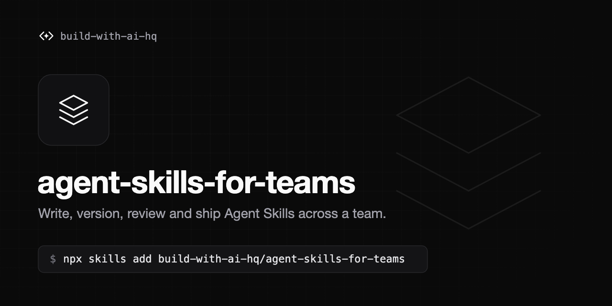

# agent-skills-for-teams

[](https://skills.sh/build-with-ai-hq/agent-skills-for-teams)

An Agent Skill that teaches your coding agent how to author, version, review, distribute and roll back Agent Skills (`SKILL.md`, agentskills.io format) across a team using Claude Code, Codex, Cursor and other harnesses.

## Problems this solves

- `SKILL.md` files copy-pasted across repos and home directories, silently drifting apart.
- No versioning, so a one-line edit changes every agent's behavior with no record or rollback.
- Skills that never trigger (or trigger on the wrong tasks) because the description is weak.
- Bloated skills that load hundreds of lines into context on every activation.
- No single way to roll a skill out to every engineer and every harness, or to roll it back.
- Unreviewed skills that bundle risky scripts.
- Harnesses that expect skills in different directories (`.claude/skills/`, `.agents/skills/`, `~/.cursor/skills/`, ...).

## Install

```bash
npx skills add build-with-ai-hq/agent-skills-for-teams
```

## What the skill does

When you ask your agent to write, fix, audit, version or ship skills, it will:

1. Audit the repo for every `SKILL.md`, copy-paste drift, oversized skills, missing versions and unreviewed scripts (bundled `scripts/lint_skills.py`, standard library only).
2. Rewrite descriptions so they trigger on real user phrasing, and set up a trigger-rate eval with train/validation splits.
3. Restructure bloated skills with progressive disclosure (`references/`, `scripts/`, explicit load conditions).
4. Apply SemVer and changelogs to skills, wire a CI lint and version-bump check, and add a review/security checklist.
5. Pick a distribution model (in-repo, shared git repo with `npx skills add`, plugin marketplace, or a central registry) and install consistently across harnesses.
6. Set up the open-source Bifrost Skills Repository when the team wants a central registry with immutable SemVer versions, served-version rollback, and a marketplace for Claude Code and Codex.

## Contents

```
SKILL.md                                   Core workflow: diagnose, fix, verify
references/writing-skills-that-trigger.md  Descriptions, body structure, progressive disclosure, trigger and output evals
references/versioning-and-review.md        SemVer for skills, changelogs, release/pin/rollback, review and security checklist, CI
references/bifrost-skills-repository.md    Central registry setup, marketplace registration, CI sync via the Skills API, runbooks
scripts/lint_skills.py                     Lints any directory of skills (spec, drift, size, links, risky scripts)
```

## License

MIT
